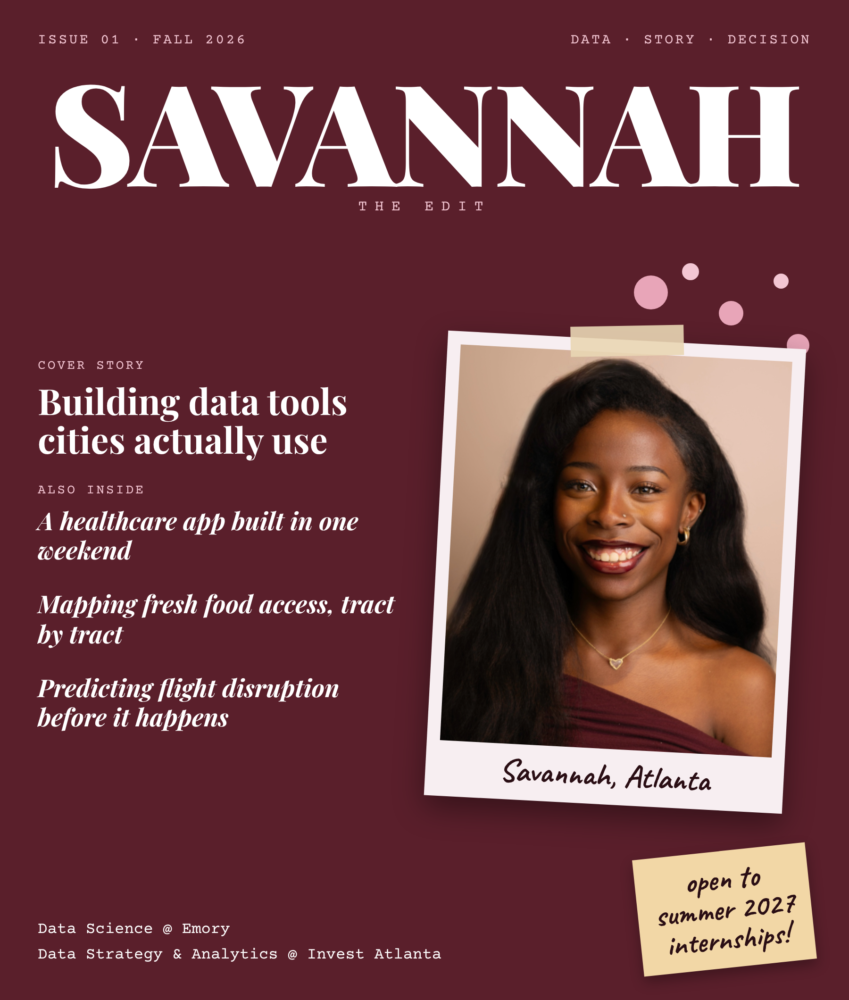
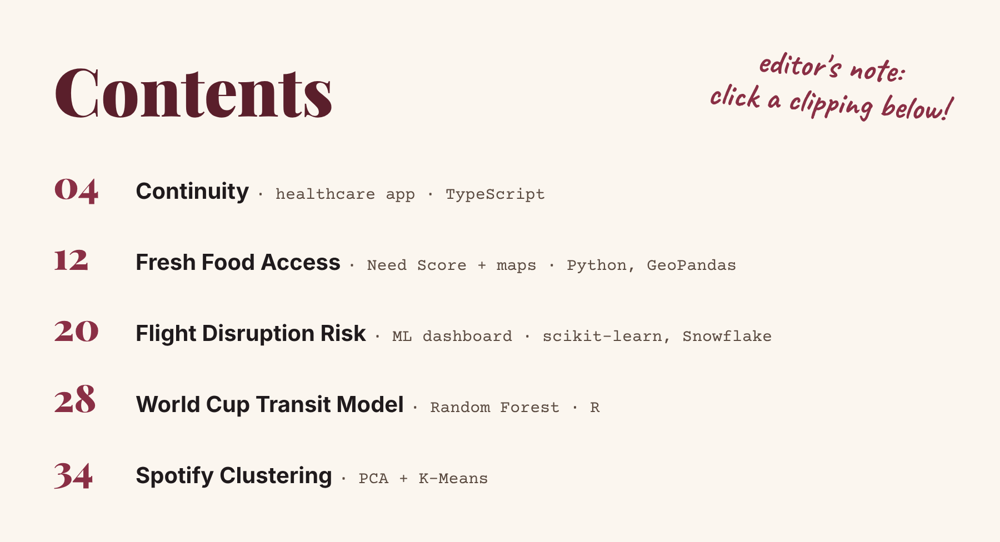
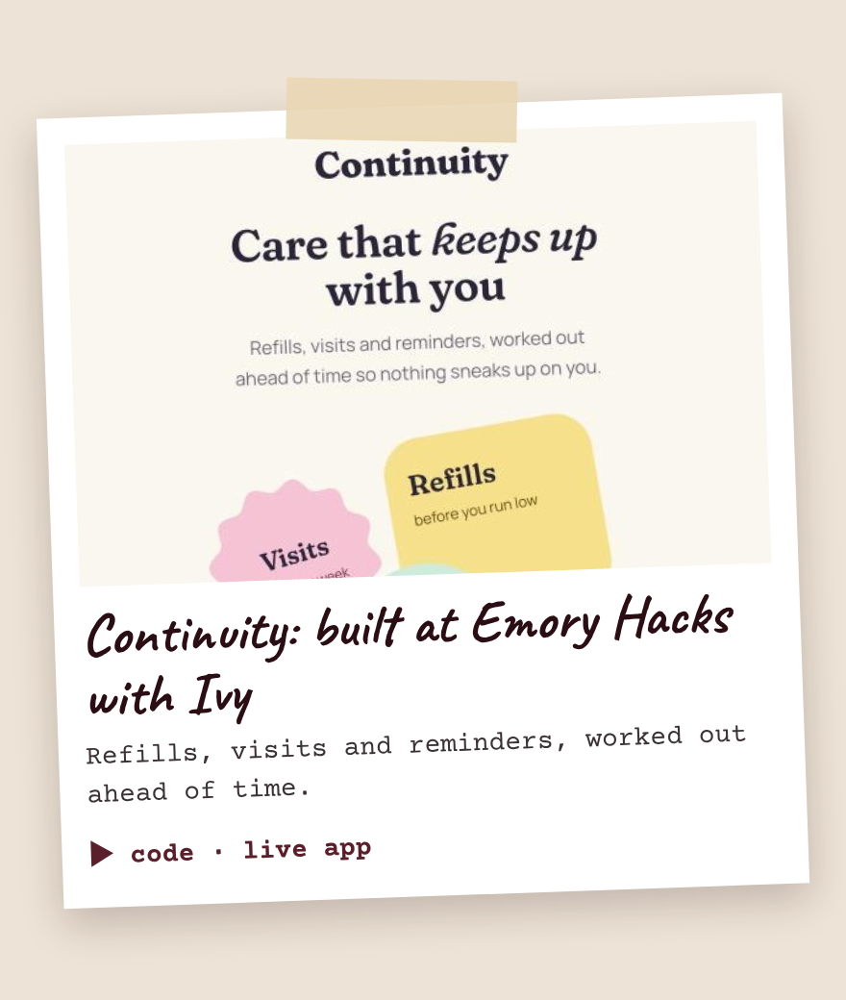
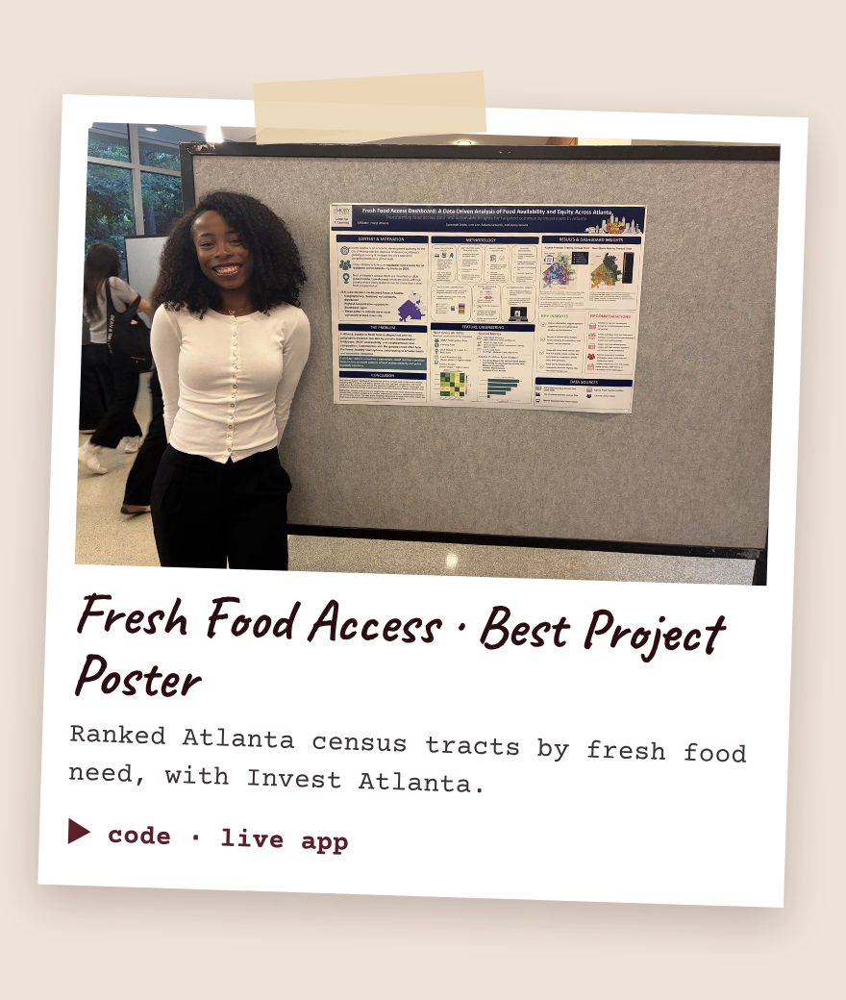
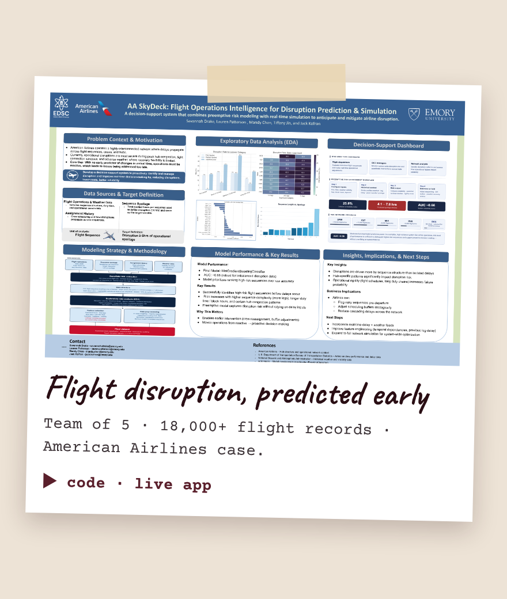
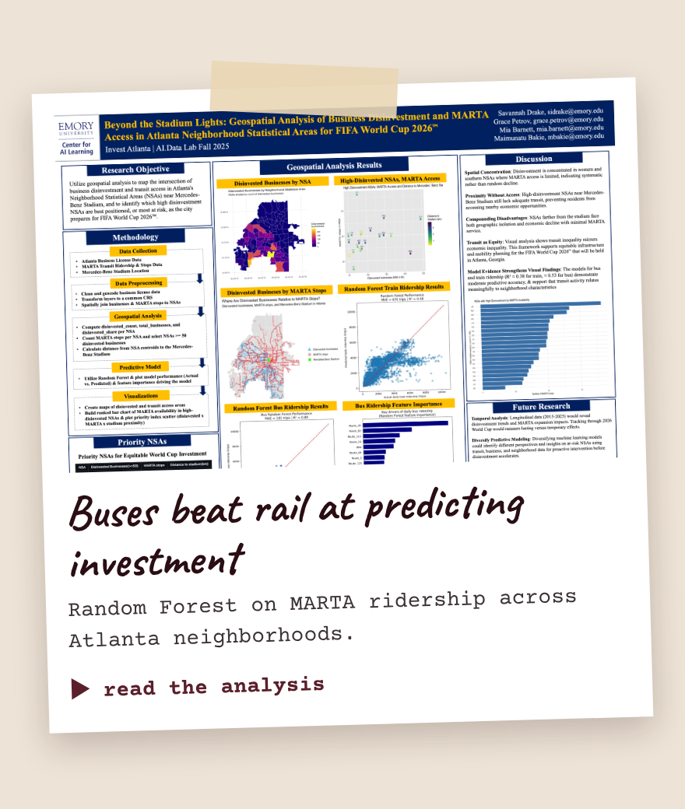
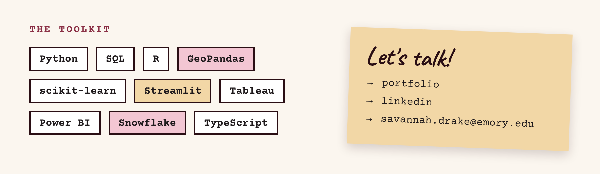

<b>Continuity</b> · <a href="https://github.com/savannah-drake/Continuity">code</a> · <a href="https://continuity-blond.vercel.app">live app</a> &nbsp;|&nbsp; <b>Fresh Food Access</b> · <a href="https://github.com/savannah-drake/fresh-food-access-dashboard">code</a> · <a href="https://fresh-food-access-dashboard.streamlit.app/">live app</a> (may take ~30s to wake)

<b>Flight Disruption Risk</b> · <a href="https://github.com/savannah-drake/B2-American-Airlines-Delay-Prediction-Project">code</a> · <a href="https://b2-american-airlines-disruption-risk.streamlit.app/">live app</a> (may take ~30s to wake) &nbsp;|&nbsp; <b>World Cup Transit Model</b> · <a href="https://github.com/savannah-drake/AI.DataLab2025InvestATL">analysis</a> &nbsp;|&nbsp; <b>Spotify Clustering</b> · <a href="https://github.com/savannah-drake/-spotify-audio-clustering">code</a>

<a href="https://savannah-drake.github.io">Portfolio</a> · <a href="https://www.linkedin.com/in/savannahdrake10/">LinkedIn</a> · <a href="mailto:savannah.drake@emory.edu">savannah.drake@emory.edu</a>

