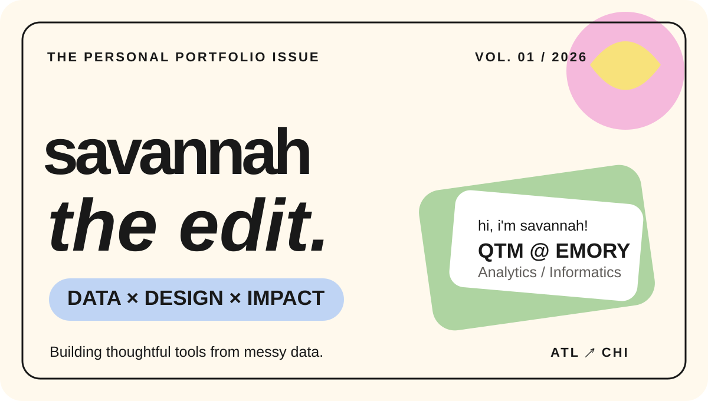
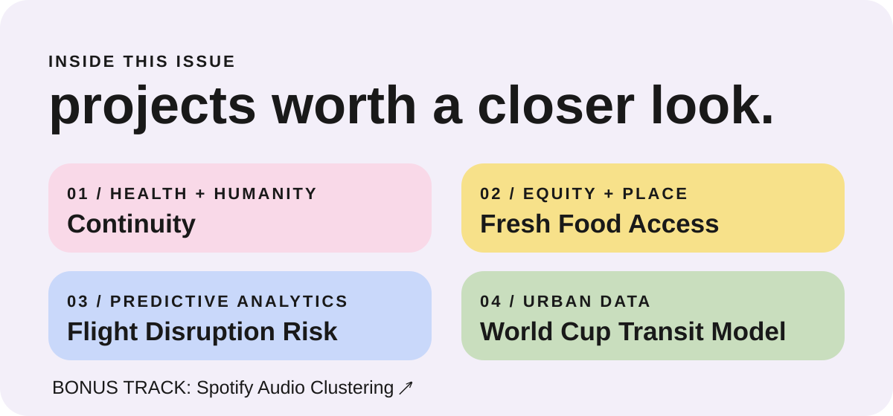
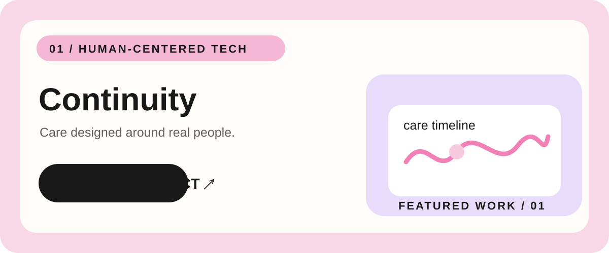
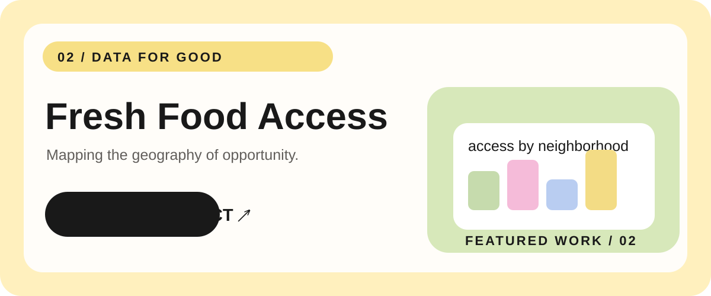
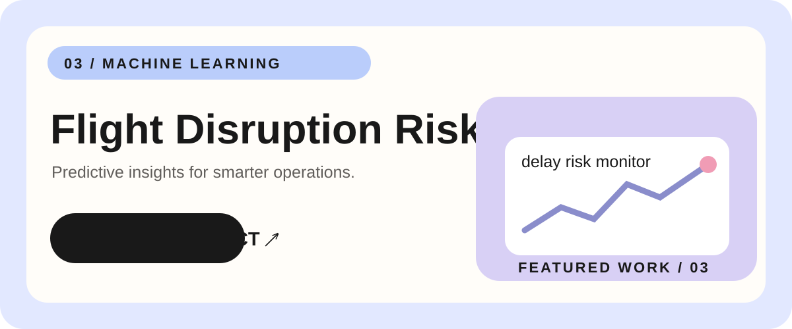
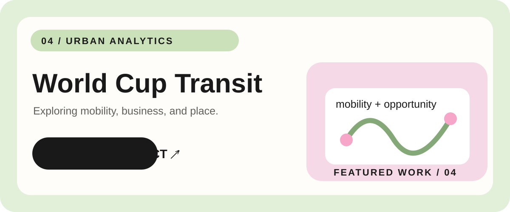
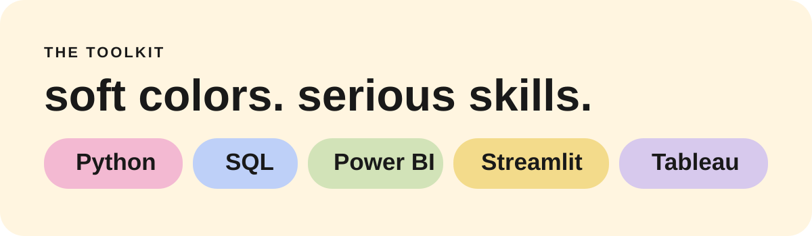

**[VIEW CODE](https://github.com/savannah-drake/Continuity)** · **[LIVE APP](https://continuity-blond.vercel.app)**

**[VIEW CODE](https://github.com/savannah-drake/fresh-food-access-dashboard)** · **[LIVE DASHBOARD](https://fresh-food-access-dashboard.streamlit.app/)**

**[VIEW CODE](https://github.com/savannah-drake/B2-American-Airlines-Delay-Prediction-Project)** · **[LIVE DASHBOARD](https://b2-american-airlines-disruption-risk.streamlit.app/)**

**[VIEW ANALYSIS](https://github.com/savannah-drake/AI.DataLab2025InvestATL)** · **[SPOTIFY CLUSTERING](https://github.com/savannah-drake/-spotify-audio-clustering)**

### let's make data mean something. ✳

[PORTFOLIO](https://savannah-drake.github.io) · [LINKEDIN](https://www.linkedin.com/in/savannahdrake10/) · [EMAIL](mailto:savannah.drake@emory.edu)

© 2026 SAVANNAH DRAKE · DATA → STORY → DECISION

